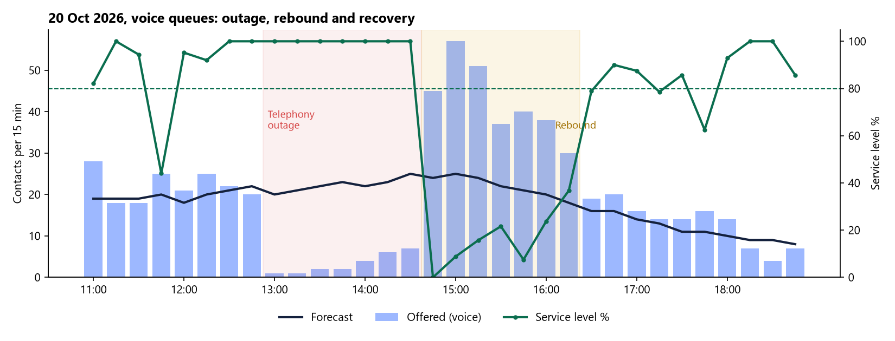
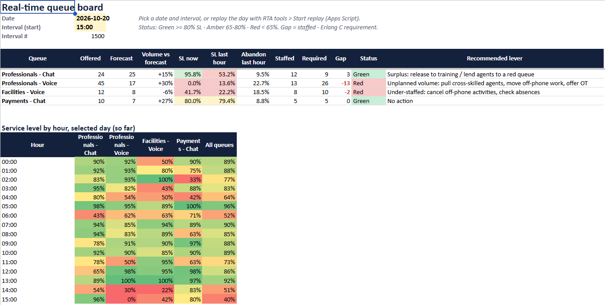
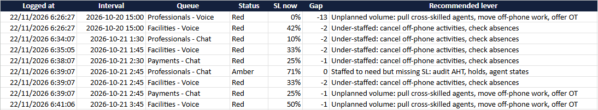
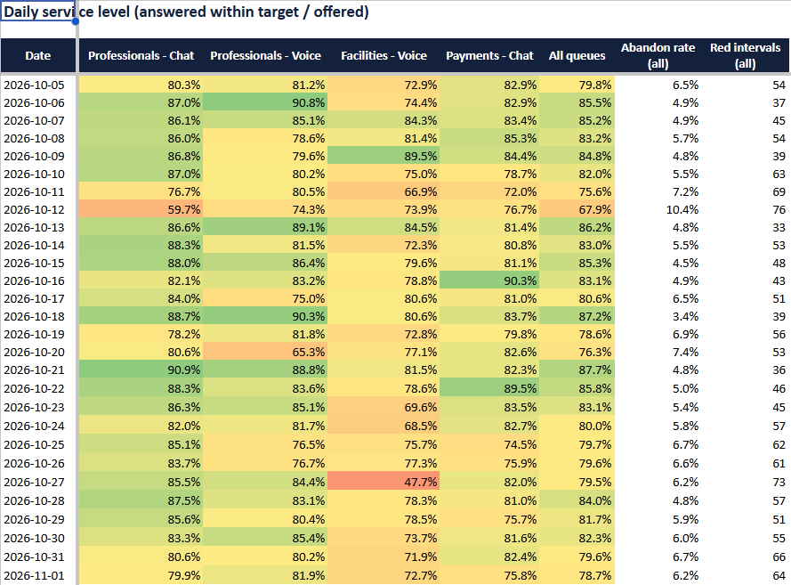
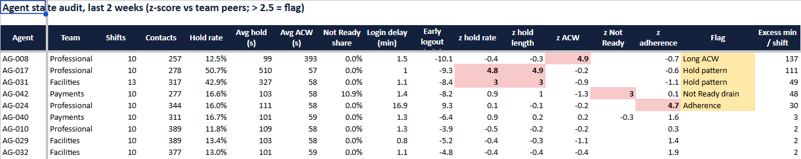
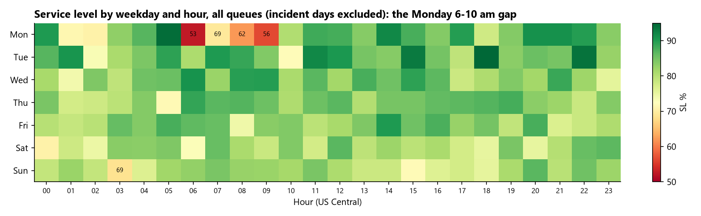
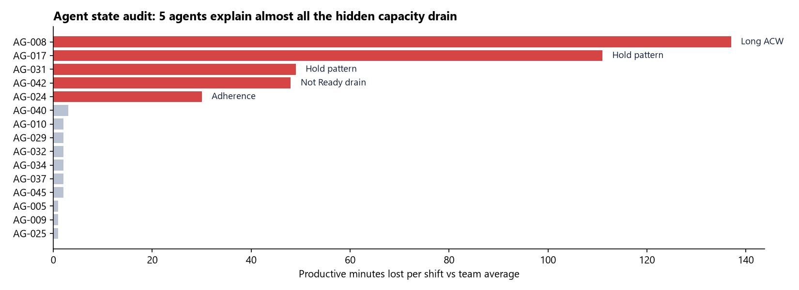

# WFM Real-Time Queue Analytics


A real-time analyst's toolkit for a 24/7 multi-queue support operation: a **live queue board** in Google Sheets, **forensic SQL** (incident detection, chronic gaps, agent state audit, cost of SLA protection), **Erlang C** staffing, and the written side of the job: an **incident update**, a **business review** and a **playbook**.

> All data is **synthetic** (`scripts/generate_data.py`, fixed seed): 4 queues (chat and voice) in 15-minute intervals for 4 weeks, plus state logs for 45 agents. Three incidents and five agents with irregular state patterns are planted in the data; the analysis has to find them without being told where they are.



## What the analysis found

| Finding | Evidence | Lever |
|---|---|---|
| **Telephony outage, then rebound** (20 Oct) | Voice arrivals −85% vs forecast for 1 h 45 min, then +94%; SL 14.8% during the rebound, 77 abandons | Cross-skill chat → voice (chat had surplus), cancel coaching, OT → [incident update](docs/incident-update-2026-10-20.md) |
| **Structural Monday-morning gap** | Mon 6–10 am: 60.3% SL vs 84.4% the rest of the week, same hours | Schedule change, not a real-time fix |
| **Paid idle capacity** | 18% of staffed hours above the Erlang C requirement (≈ $41.7k at $14/h) while 814 hours were short | Move surplus hours into the gap |
| **Hidden capacity drain** | 5 agents: long ACW, hold pattern ×2, Not Ready micro-breaks, adherence; 375 min/shift ≈ 0.78 FTE | Team Lead review, re-audit in 2 weeks |
| **Absenteeism day** (27 Oct, Facilities - Voice) | SL 47.7% vs 76.8% on a typical day | Same-day call-out list |
| **Unforecasted chat spike** (12 Oct) | +70% vs forecast at the morning peak; daily chat SL 59.7% | Re-forecast, overflow |

Full write-up: [business review](docs/weekly-business-review.md) · [playbook](docs/rta-playbook.md).

## Google Sheets live board

[`sheets/RTA_Queue_Tracker.xlsx`](sheets/RTA_Queue_Tracker.xlsx) is built to be imported into Google Sheets. Every number on the board is a formula (`SUMIFS`, `IF`, `DATEVALUE`, conditional formatting) over the interval data, so it works as a template for live data too.



*The Live Board after importing into Google Sheets, at 15:00 on 20 Oct: voice is red during the outage rebound while Professionals - Chat has 3 agents of surplus to lend.*

| Tab | What it does |
|---|---|
| **Live Board** | Pick a date and interval: per queue offered vs forecast, SL now and last hour, abandon rate, staffed vs Erlang C requirement, **status (green / amber / red) and the recommended lever**; plus SL by hour for the selected day |
| **Daily SLA** | Service level by day and queue with a colour scale; abandon rate and red intervals |
| **Agent Audit** | The forensic state audit with z-scores, flags and FTE recovered |
| **Anomalies** | Volume spikes and drops grouped into episodes |
| **Playbook** | Triggers → first lever → escalation → owner → update cadence |
| **Alert Log** | Filled by the Apps Script |

[`apps-script/rta_tools.gs`](apps-script/rta_tools.gs) adds an **RTA tools** menu: *Check queues now* (logs red and amber queues with the lever), *Next interval*, and **Start replay**, a time-driven trigger that moves the board one interval per minute so a past day can be watched as if it were live.

Tested in Google Sheets: *Check queues now* at 20 Oct 15:00 logs exactly the two red queues, and *Next interval* keeps stepping through the night and logging every red or amber queue with its lever:



| Daily SLA | Agent Audit |
|---|---|
|  |  |

The Google Sheets test also surfaced a gap in the lever rules: an **amber queue that was already under-staffed** got "No action". It now gets "Slipping and under-staffed: cancel off-phone work before it turns red", in both the board formula and the SQL.

The formulas were checked in Google Sheets and by recalculating the workbook in Excel: for 20 Oct 15:00 the board returns the same values as `sql/01_realtime_queue_board.sql` (Professionals - Voice: 45 offered vs 17 forecast, gap −13, Red, "pull cross-skilled agents"; Professionals - Chat: Green with +3 surplus).

## SQL

Written for SQLite so the repo runs anywhere; the queries are plain ANSI-style SQL with CTEs and window functions, ready to become Metabase questions (the `{{as_of}}` variable is marked where it goes).

| File | What it answers |
|---|---|
| [`00_model.sql`](sql/00_model.sql) | One clean interval table joining ACD and WFM data, plus a view with SL, abandon rate, forecast variance, staffing gap and RAG status |
| [`01_realtime_queue_board.sql`](sql/01_realtime_queue_board.sql) | The board: latest interval + last hour per queue, and the lever to pull |
| [`02_daily_sla_and_heatmap.sql`](sql/02_daily_sla_and_heatmap.sql) | Daily SL; weekday × hour heatmap; **chronic gaps** (cells under target on 3+ weeks) |
| [`03_anomaly_islands.sql`](sql/03_anomaly_islands.sql) | **Incident detection** with the gaps-and-islands pattern (`ROW_NUMBER` difference) |
| [`04_forecast_and_staffing_cost.sql`](sql/04_forecast_and_staffing_cost.sql) | Forecast WAPE and bias; surplus and shortfall agent-hours and their cost |
| [`05_agent_state_audit.sql`](sql/05_agent_state_audit.sql) | **Forensic audit**: holds, ACW, Not Ready, adherence vs schedule, z-scores against team peers |
| [`06_incident_timeline.sql`](sql/06_incident_timeline.sql) | Interval timeline for the incident update |

Incident detection, the core of it:

```sql
SELECT f.*,
       ROW_NUMBER() OVER (PARTITION BY queue ORDER BY interval_start)
     - ROW_NUMBER() OVER (PARTITION BY queue, anomaly ORDER BY interval_start) AS island
FROM flagged f            -- each run of consecutive anomalous intervals gets one island id
```

## Erlang C

[`scripts/erlang.py`](scripts/erlang.py) computes service level and required agents (with an occupancy cap; chat uses concurrency 2). It reproduces the textbook case: 100 calls in 30 min, AHT 180 s, 80/20 → 13 agents give 79.6%, 14 give 88.8%. The requirement is computed for the contacts that **actually** arrived, which is what makes the staffing-gap and surplus-cost numbers fair.





## How to run

```bash
pip install -r requirements.txt
python scripts/generate_data.py     # synthetic data -> data/raw/
python scripts/run_analysis.py      # SQLite + SQL -> results/*.csv
python scripts/build_workbook.py    # -> sheets/RTA_Queue_Tracker.xlsx
python scripts/build_reports.py     # -> docs/img/*.png and the docs
```

Google Sheets: *File → Import → Upload* the xlsx, then *Extensions → Apps Script*, paste `apps-script/rta_tools.gs`, save and reload.

## Project structure

```
data/raw/            synthetic ACD, WFM, roster, schedules and agent state logs
sql/                 the analysis, one question per file
scripts/             data generator, Erlang C, pipeline, workbook and report builders
results/             query outputs (CSV)
sheets/              Google Sheets live board (xlsx to import)
apps-script/         RTA tools menu, alert log and replay trigger
docs/                incident update, business review, playbook, charts
```

---
Ramiro Di Bernardo · [LinkedIn](https://www.linkedin.com/in/ramiro-di-bernardo) · [GitHub](https://github.com/Ramiro-DiBernardo)
