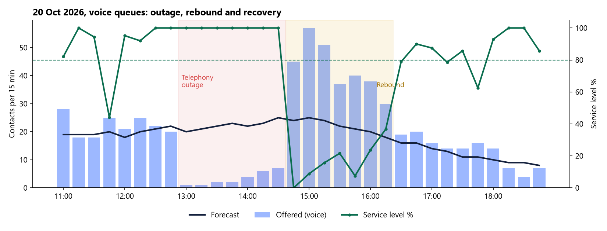

# Incident update: voice outage and rebound, Tue 20 Oct 2026

*Written as the RTA would send it to Ops leadership. Synthetic data; times in US Central.*

**Status:** resolved · **Queues:** Professionals - Voice, Facilities - Voice · **Window:** 13:00 – 16:30

## Impact
- **13:00 – 14:45, outage.** Voice arrivals fell to **23 contacts vs 156 forecast (-85%)**. Healthcare professionals and facilities could not reach us by phone for 1 h 45 min. Queue metrics looked "green" because nobody could get in, which is why a volume drop is treated as an incident signal, not good news.
- **14:45 – 16:30, rebound.** Callers came back at once: **298 contacts vs 153 forecast (+94%)**. Service level fell to **14.8%** and **77 callers abandoned**. Staffed agents covered **71%** of the Erlang C requirement in that window.
- **Recovery:** voice service level was back above 80% at **16:45**. Day result: Professionals - Voice 65.3%, Facilities - Voice 77.1% (target 80%).

## Cause
Telephony platform outage (inbound calls failing before reaching the queue), detected by the volume-drop rule in `sql/03_anomaly_islands.sql`: arrivals under 40% of forecast for 45 minutes or more. The rebound was the backlog of callers retrying.

## Levers (from the playbook and the live board, in order)
1. **At 13:45, outage confirmed:** open an incident with the platform team; push in-app / SMS notice so professionals use chat; keep voice agents on shift for the rebound instead of releasing them to off-phone work.
2. **At 15:00, rebound:** the board showed Professionals - Voice **Red** with a gap of 13 agents while Professionals - Chat was **Green with surplus** (+8 agent-intervals over requirement during the rebound). Lever: move cross-skilled chat agents to voice, cancel the 15:30 coaching sessions, offer voluntary overtime to the evening shift.
3. **From 16:30:** return agents to their home queues as SL holds above 80% for two intervals.

## Follow-ups
| Action | Owner | Due |
|---|---|---|
| Add the "volume < 40% of forecast for 45 min" rule (already in the SQL) as a live alert on the Sheets board | RTA | 1 week |
| Pre-approved cross-skill list chat → voice for rebounds | WFM + Team Leads | 1 week |
| Ask platform team for outage start / end timestamps to measure detection time | Ops Manager | 1 week |

## All anomaly episodes detected in the 4 weeks
| Queue | Type | Window | Offered vs forecast | Variance | Abandoned |
|---|---|---|---|---|---|
| Professionals - Chat | Volume spike | 2026-10-12 07:30 → 08:15 | 182 vs 107 | +70% | 59 |
| Professionals - Chat | Volume spike | 2026-10-12 20:45 → 21:30 | 71 vs 47 | +52% | 13 |
| Professionals - Chat | Volume spike | 2026-10-16 08:00 → 08:45 | 110 vs 76 | +44% | 39 |
| Facilities - Voice | Volume drop | 2026-10-20 13:00 → 14:00 | 2 vs 31 | -94% | 0 |
| Professionals - Voice | Volume drop | 2026-10-20 13:00 → 14:30 | 10 vs 87 | -88% | 0 |
| Professionals - Voice | Volume spike | 2026-10-20 14:45 → 16:15 | 196 vs 93 | +112% | 57 |
| Professionals - Chat | Volume spike | 2026-10-27 12:15 → 13:00 | 71 vs 48 | +48% | 16 |
