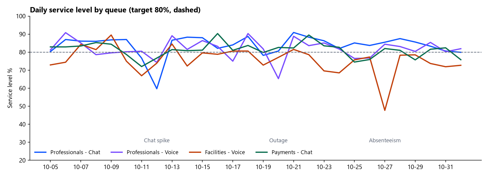
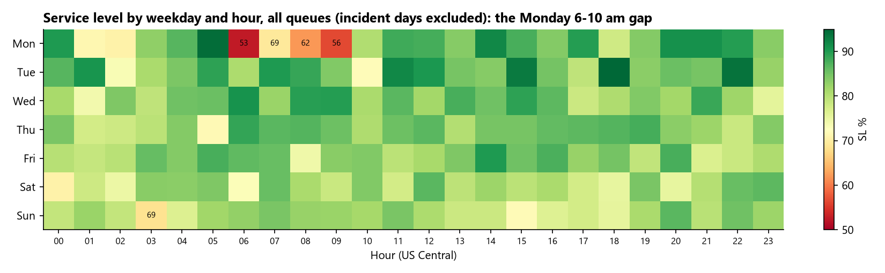
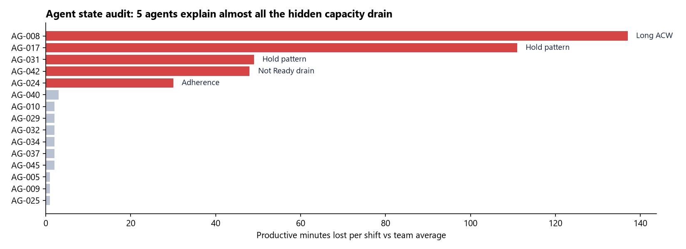

# Business review: support queues, 5 Oct – 1 Nov 2026

*Four-week review written for Ops leadership. Synthetic data; every number is computed by `scripts/build_reports.py` from the SQL results.*

## The short version
1. **Service level was 81.5% against an 80% target** over 89,320 contacts, with 5.9% abandonment. The average hides two problems: **Facilities - Voice missed target (75.6%)**, and **every Monday morning there is a structural hole in the schedule.** Three one-off incidents added to the misses.
2. **Mondays 6–10 am run at 60.3% SL vs 84.4% on other days in the same hours** (3 Mondays, incidents excluded). Staffing sits -0.3 agents vs requirement on average, against +1.2 the rest of the week. This is a scheduling fix, not a real-time one.
3. **We pay for capacity we do not use at other times:** 2,982 of 16,122 staffed agent-hours (18%) were above the Erlang C requirement, about **$41,738** at an assumed $14 per loaded hour, while 814 hours were short. Moving part of that surplus into Monday mornings protects SLA at no extra cost.
4. **Five agents explain almost all of the hidden capacity drain** found by the state audit: 375 productive minutes per shift between them, **≈ 0.78 FTE**.

## Service level and forecast accuracy
| Queue | Contacts | Service level | Abandon rate | Daily forecast error (WAPE) | Forecast bias |
|---|---:|---:|---:|---:|---:|
| Professionals - Chat | 39,000 | 83.5% | 5.5% | 4.0% | +0.2% |
| Professionals - Voice | 23,991 | 81.6% | 5.6% | 4.3% | -0.5% |
| Facilities - Voice | 12,427 | 75.6% | 8.0% | 5.0% | +0.7% |
| Payments - Chat | 13,902 | 81.2% | 5.8% | 5.4% | -0.5% |

Forecasts are accurate at day level (WAPE around 5%) and unbiased, so the misses are not a forecasting problem; interval-level error is naturally higher on small queues.

## Structural gap: Monday mornings

The heatmap leaves out the three incident days, so what remains is the shape of the schedule. The red block on Monday 6–10 am appears every week; `sql/02_daily_sla_and_heatmap.sql` lists it in `chronic_gaps`. Callers abandoned 365 times in those hours across 3 Mondays.

**Recommendation:** shift 2–3 agents' Monday start from 9 am to 6 am (or add a 6–10 am split shift), funded from the surplus hours below.

## Fiscal efficiency of SLA protection
| Queue | Staffed hours | Surplus hours (share) | Shortfall hours | Surplus cost | Abandons while short |
|---|---:|---:|---:|---:|---:|
| Facilities - Voice | 3,376 | 718 (21%) | 276 | $10,056 | 804 |
| Payments - Chat | 2,596 | 477 (18%) | 158 | $6,671 | 608 |
| Professionals - Chat | 4,935 | 838 (17%) | 166 | $11,732 | 1662 |
| Professionals - Voice | 5,215 | 949 (18%) | 214 | $13,279 | 991 |

Surplus = staffed above the Erlang C requirement for the contacts that actually arrived (80% target). Some surplus is the price of variability; above ~10–12% it is money that could be moved to the hours that miss.

## Incidents
- **Mon 12 Oct, Professionals - Chat:** unforecasted spike after an app release (detected 07:30 – 08:15, +70% vs forecast). Daily chat SL fell to 59.7%.
- **Tue 20 Oct, voice:** telephony outage and rebound, see [incident update](incident-update-2026-10-20.md).
- **Tue 27 Oct, Facilities - Voice:** high absenteeism. Staffed 90 agent-hours vs 106 required; SL 47.7% vs 76.8% on a typical day, abandonment 14.8%. Lever for next time: same-day call-out list and cross-skilling Professionals - Voice agents into Facilities.

## Agent state audit (last 2 weeks)

| Agent | Team | Flag | Holds | ACW | Login delay / early logout (min; negative = stayed late) | Excess min/shift |
|---|---|---|---|---|---|---:|
| AG-008 | Professionals | Long ACW | 0.125 holds/contact · 99.0 s avg hold | 393 s ACW | 1.5 / -10.1 | 137 |
| AG-017 | Professionals | Hold pattern | 0.507 holds/contact · 510.0 s avg hold | 57 s ACW | 1.0 / -9.3 | 111 |
| AG-031 | Facilities | Hold pattern | 0.429 holds/contact · 327.0 s avg hold | 58 s ACW | 1.1 / -8.4 | 49 |
| AG-042 | Payments | Not Ready drain | 0.166 holds/contact · 103.0 s avg hold | 58 s ACW | 1.4 / -8.2 | 48 |
| AG-024 | Professionals | Adherence | 0.16 holds/contact · 111.0 s avg hold | 58 s ACW | 16.9 / 9.3 | 30 |

Each agent is compared with peers on the same team (z-score above 2.5), so a team with longer handle times does not create false positives. The audit is a starting point for a Team Lead conversation, not a verdict: a long hold pattern can also mean a knowledge gap or a broken tool.

## Asks
1. Approve the Monday 6–10 am schedule change (no headcount change).
2. Pre-approve a chat → voice cross-skill list for outages and rebounds.
3. Team Leads review the five flagged agents and report back in two weeks.
